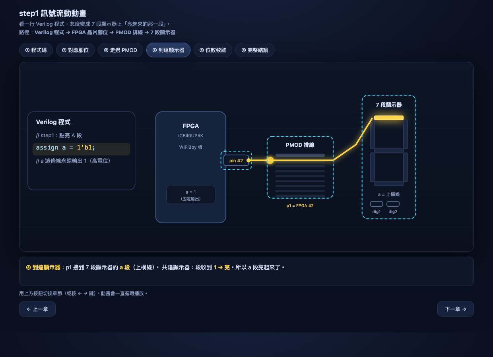

# step1：點亮 A 段

## 🎬 先看動畫（推薦）

用瀏覽器打開 [`訊號流動動畫.html`](訊號流動動畫.html)，會用 6 個章節示範：
**Verilog 程式 → FPGA pin 42 → PMOD p1 → 7 段顯示器 A 段** 的完整訊號流動。

（直接用 Chrome / Safari 開啟即可；也可加 `?ch=4` 直接跳到「到達顯示器」那章。）



## 目的
確認「程式 → 腳位 → LED」這條路是通的。

---

## 程式碼說明

### ① 模組宣告
```verilog
module seg_one (
    input  clk12,
    output a,
    output dig1, dig2
);
```
- `module ... endmodule`：一個「電路模組」的頭尾。
- `input clk12`：輸入腳（12MHz 時鐘）。這步其實用不到時鐘，但 PCF 要對應，所以留著。
- `output a`：輸出腳（A 段）。
- `output dig1, dig2`：位數致能腳（**關鍵！**）。

### ② 把 A 段點亮
```verilog
assign a = 1'b1;
```
- `assign`：持續輸出某個值（組合邏輯，沒有記憶）。
- `1'b1`：1 個 bit、值為 1（高電位）。
- 共陰顯示器：段給 1 → 亮。

### ③ 位數致能（很多人卡在這）
```verilog
assign dig1 = 1'b0;
assign dig2 = 1'b0;
```
- 7 段顯示器有**兩組腳**：「段」和「位數」。
- 共陰：位數給 **0** → 致能（亮）。
- 只給段、沒致能位數 → **整顆不亮**。

---

## 執行
```bash
cd step1
make
make prog
```

## 應該看到
兩位數的 **A 段**同時亮起（上面那條橫線）。

## 沒亮怎麼辦
把 `a` 改成 `1'b0` 試試：
- 改成 0 反而亮 → 你的顯示器是**共陽**：`dig1/dig2` 改 `1'b1`、段改 `1'b0`。
- 兩種都不亮 → 腳位可能不對，去做 step3。
