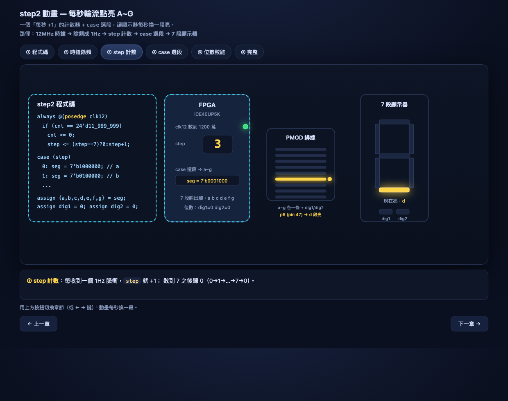

# step2：輪流點亮 A~G

## 🎬 先看動畫（推薦）

用瀏覽器打開 [`輪流點亮動畫.html`](輪流點亮動畫.html)，會用 6 個章節示範
**12MHz 時鐘 → 除頻 1Hz → step 計數 → case 選段 → 7 段顯示器** 的完整流程。



## 目的
確認 7 段都接對、都活著。

---

## 程式碼說明

### ① 宣告暫存器
```verilog
reg [2:0] step = 0;     // 3-bit，可存 0~7
reg [23:0] cnt  = 0;    // 24-bit，可數到 16,777,215
```
- `reg`：可以「記住值」的訊號（對應實際電路裡的暫存器）。
- `[2:0]`：3 個 bit。

### ② 每秒換一段（時序邏輯）
```verilog
always @(posedge clk12) begin
    if (cnt == 24'd11_999_999) begin
        cnt  <= 0;
        step <= (step == 7) ? 0 : step + 1;
    end else
        cnt <= cnt + 1;
end
```
- `always @(posedge clk12)`：**每個時鐘上升緣**執行一次（時序邏輯）。
- `12MHz 數 12,000,000 次 = 1 秒`（`24'd11_999_999` 是從 0 數到 11,999,999）。
- `<=`：非阻塞賦值（電路會「同時」更新）。
- `? :`：三元運算子（`條件 ? 成立時 : 不成立時`）。

### ③ case 決定哪一段亮（組合邏輯）
```verilog
always @* begin
    case (step)
        0: seg = 7'b1000000;  // 只給 a
        ...
    endcase
end
```
- `always @*`：只要輸入變了就算（組合邏輯，沒有時鐘）。
- `case`：多選一，類似 C 的 switch。
- `7'b1000000`：7 個 bit，最左邊是 a → 只有 a 亮。

### ④ 拆到 7 個輸出腳
```verilog
assign {a, b, c, d, e, f, g} = seg;
```
- `{...}`：**位元拼接**，把 `seg[6:0]` 拆給 7 個輸出。

---

## 執行
```bash
cd step2
make
make prog
```

## 應該看到
A→B→C→D→E→F→G 每秒輪流亮。

## 除錯
- 某一段不亮 → 腳位可能錯，去做 step3。
- 順序怪 → 段位順序可能不同，把 PCF 的 a~g 對調試試。
