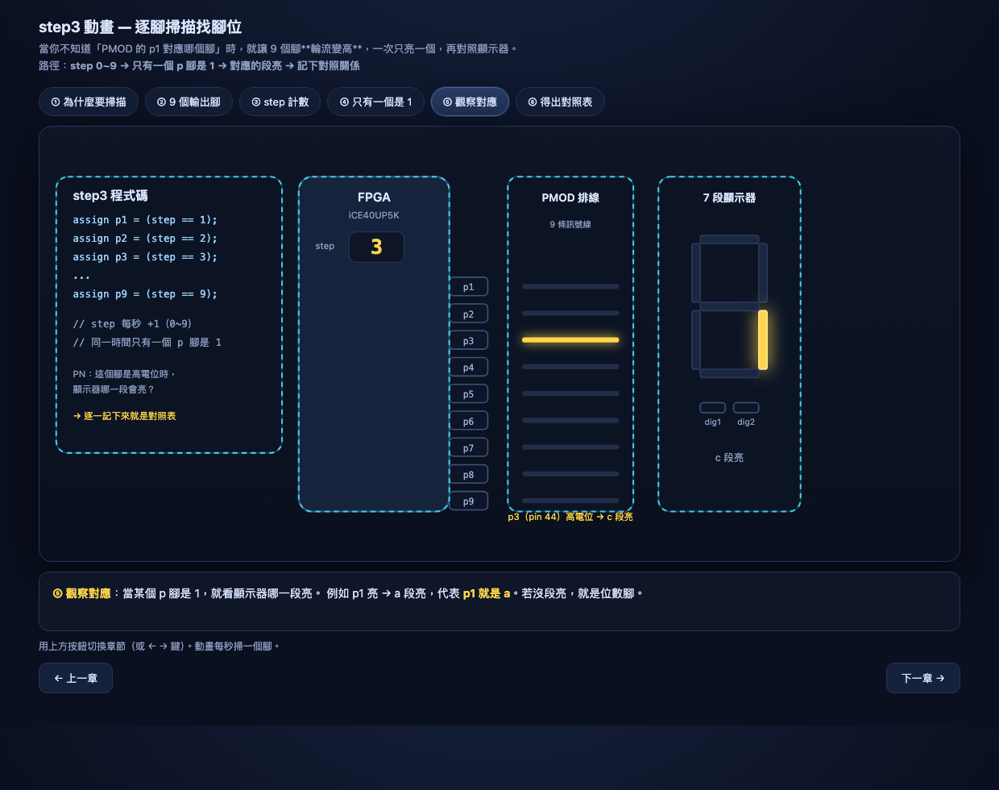

# step3：逐腳掃描（找腳位）

## 🎬 先看動畫（推薦）

用瀏覽器打開 [`逐腳掃描動畫.html`](逐腳掃描動畫.html)，會用 6 個章節示範
**9 個腳輪流拉高 → 觀察哪一段亮 → 得出腳位對照表**。



## 目的
當你不確定「PMOD 的 p1 對應 FPGA 哪個腳」時，用最笨但最有效的方法找出對應關係。

---

## 程式碼說明

### ① 9 個輸出腳
```verilog
output p1, p2, p3, p4, p5, p6, p7, p8, p9
```
- 把 PMOD 的 9 個訊號腳全部拉出來。

### ② 每秒走一步
```verilog
if (cnt == 24'd11_999_999) begin
    cnt  <= 0;
    step <= (step == 9) ? 0 : step + 1;
end
```
- 和 step2 一樣的「每秒 +1」計數器，範圍 0~9。

### ③ 只有一個腳會是 1
```verilog
assign p1 = (step == 1);
assign p2 = (step == 2);
...
```
- `(step == 1)` 這種寫法會產生 **1 bit 的結果**（1 或 0）。
- 所以任何時刻，**只有一個 p 腳是 1**，其餘都是 0。

---

## 執行
```bash
cd step3
make
make prog
```

## 怎麼用
拿紙筆，每秒記下「現在哪個段亮」，配合腳位表（p1=42, p2=43, p3=44, p4=45, p5=46, p6=47, p7=48, p8=2, p9=3），就能反推出真正的腳位對照。

> ⚠️ 這個程式會「亂點亮」顯示器（不是照段碼送），目的是**觀察對應**，不是正常顯示。

## 學到
硬體除錯的基本功——**先假設、再測、再修正**。本專案當初就是靠這招，發現 PMOD 標示是反的。
