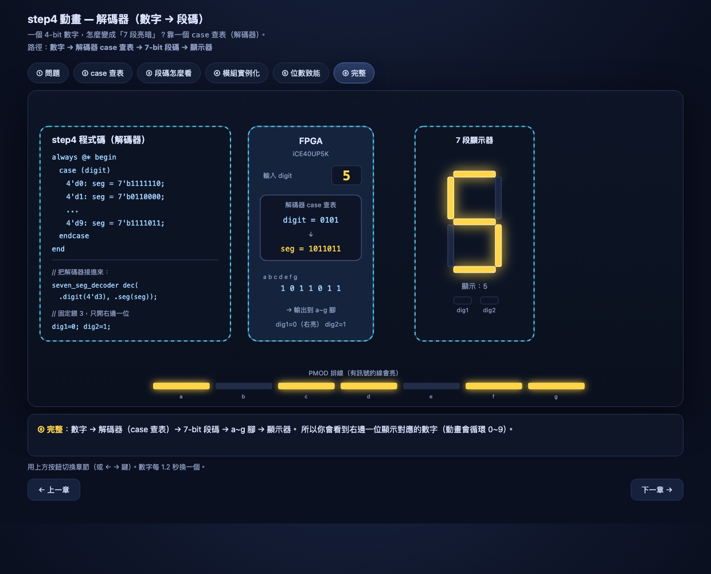

# step4：解碼器 + 顯示固定數字

## 🎬 先看動畫（推薦）

用瀏覽器打開 [`解碼器動畫.html`](解碼器動畫.html)，會用 6 個章節示範：
**數字 → 解碼器（case 查表）→ 7-bit 段碼 → 顯示器**。



## 目的
把「數字」變成「段碼」，先確認解碼正確。

---

## 程式碼說明

### ① 解碼器（decoder.v）
```verilog
module seven_seg_decoder (
    input  [3:0] digit,
    output reg [6:0] seg
);
    always @* begin
        case (digit)
            4'd0: seg = 7'b1111110;
            ...
        endcase
    end
endmodule
```
- `input [3:0] digit`：4-bit 輸入（可表示 0~15）。
- `output reg [6:0] seg`：7-bit 輸出（a~g）。
- `always @*`：純組合邏輯（輸入變 → 輸出馬上變，不用時鐘）。
- `case`：把「數字」查表成「段碼」。
- **`7'b1111110` 怎麼看**：從左到右是 a,b,c,d,e,f,g，`1`=亮。
  所以 `1111110` = a~f 亮、g 暗 = 「0」。

### ② 主模組（show_fixed.v）
```verilog
wire [6:0] seg;
seven_seg_decoder dec(.digit(4'd3), .seg(seg));
```
- `wire`：一條「內部連線」（不是暫存器）。
- **模組實例化**：`seven_seg_decoder dec(...)` 把解碼器「接進來」。
  - `.digit(4'd3)`：把固定值 3 接到解碼器的輸入。
  - `.seg(seg)`：把解碼器的輸出接到內部的 `seg`。

### ③ 接到腳位
```verilog
assign {a, b, c, d, e, f, g} = seg;
assign dig1 = 1'b0;   // 啟用右邊一位
assign dig2 = 1'b1;   // 關閉左邊
```

---

## 執行
```bash
cd step4
make
make prog
```

## 應該看到
右邊一位顯示 **3**。

## 除錯
- 顯示反相（該亮的不亮）→ 共陽，把段碼和 dig 都反相（或等 step9）。
- 顯示錯亂 → 腳位不對，回去做 step3。
