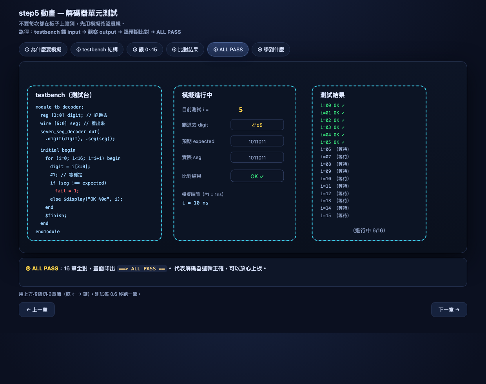

# step5：解碼器單元測試（純模擬，不碰板子）

## 🎬 先看動畫（推薦）

用瀏覽器打開 [`單元測試動畫.html`](單元測試動畫.html)，會用 6 個章節示範：
**testbench 餵 input → 比對 output → ALL PASS**。



## 目的
不要每次都在板子上瞎猜，先用模擬確認邏輯。

---

## 程式碼說明

### ① testbench 沒有 input/output
```verilog
module tb_decoder;
    reg  [3:0] digit;
    wire [6:0] seg;
```
- testbench 是「測試台」，它**自己產生訊號**，所以沒有 input/output。
- `reg`：由 testbench 主動驅動的訊號（送給待測物）。
- `wire`：觀察待測物的輸出。

### ② 把待測物接進來
```verilog
seven_seg_decoder dut(.digit(digit), .seg(seg));
```
- `dut` = **D**evice **U**nder **T**est（待測物）。
- 把要被測的模組接進來，輸入接 `digit`、輸出接 `seg`。

### ③ 模擬開始時跑一次
```verilog
initial begin
    for (i = 0; i < 16; i = i + 1) begin
        digit = i[3:0];
        #1;                        // 等 1 ns 讓輸出穩定
        case (i) ... endcase       // 對照表
        #1;
        if (seg !== expected) ...  // 比對
    end
    $finish;                       // 結束模擬
end
```
- `initial`：模擬一開始執行一次（不會重複）。
- `for`：迴圈 0~15。
- `#1`：延遲 1 ns。
- `$display`：印出文字。
- `!==`：**嚴格比對**（連 `x`、`z` 也會判斷，一般 `!=` 遇到 x 會亂比）。
- `$finish`：告訴模擬器「結束」。

---

## 執行
```bash
cd step5
make sim
```

## 應該看到
```
OK   digit=0 seg=1111110
...
==> ALL PASS ==
```

## 學到
模擬快、可重複、不用碰硬體，是除錯的好幫手。
