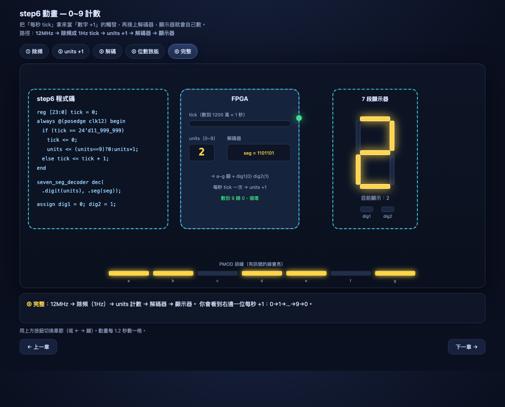

# step6：0~9 計數（單一位數）

## 🎬 先看動畫（推薦）

用瀏覽器打開 [`計數動畫.html`](計數動畫.html)，會用 6 個章節示範：
**除頻（1Hz）→ units 計數 → 解碼器 → 每秒 +1**。



## 目的
讓顯示器自己「動起來」。

---

## 程式碼說明

### ① 除頻計數器（12MHz → 1Hz）
```verilog
reg [3:0]  units = 0;
reg [23:0] tick  = 0;
always @(posedge clk12) begin
    if (tick == 24'd11_999_999) begin
        tick <= 0;
        ...
    end else
        tick <= tick + 1;
end
```
- `tick` 從 0 數到 11,999,999（共 1200 萬次），剛好 **1 秒**。
- 數滿就把 `tick` 歸零 → 產生一個「每秒一次的脈衝」。

### ② 個位數 +1（0~9 循環）
```verilog
if (units == 4'd9) units <= 4'd0;
else               units <= units + 1;
```
- 數到 9 就歸 0，否則 +1。

### ③ 接上解碼器
```verilog
wire [6:0] seg;
seven_seg_decoder dec(.digit(units), .seg(seg));
assign {a, b, c, d, e, f, g} = seg;
```
- 把 `units` 丟給解碼器，解碼器吐段碼，再接到 7 個腳。

### ④ 位數致能
```verilog
assign dig1 = 1'b0;   // 啟用右邊一位
assign dig2 = 1'b1;   // 關閉左邊
```

---

## 執行
```bash
cd step6
make
make prog
```

## 應該看到
右邊一位每秒 +1：0→1→…→9→0。

## 學到
除頻（12MHz → 1Hz）＋ 計數器 ＋ 解碼器的組合。
