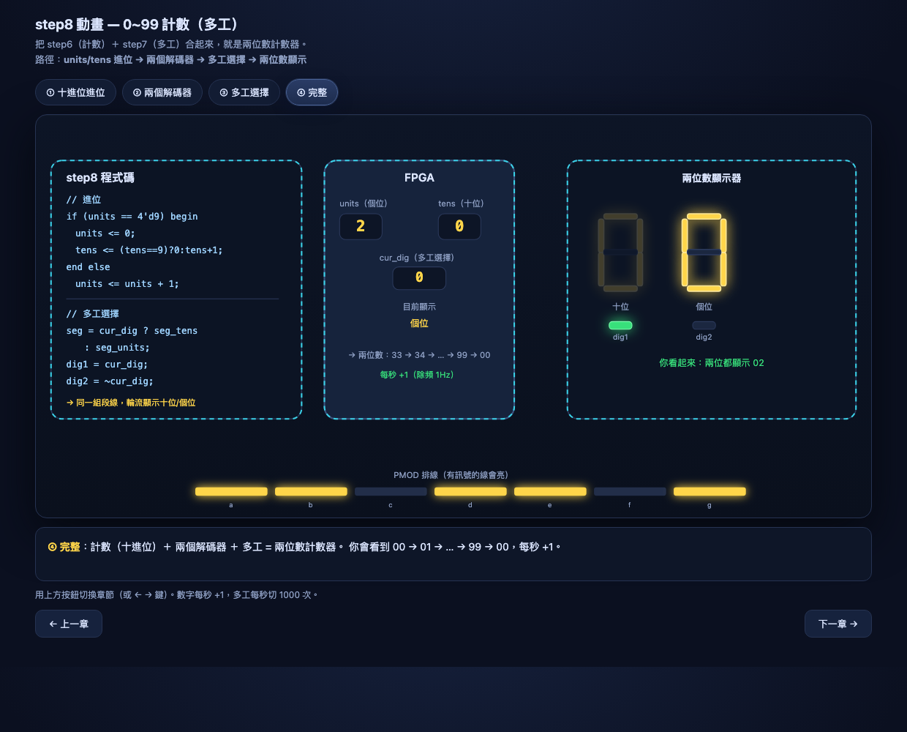

# step8：0~99 計數（多工）

## 🎬 先看動畫（推薦）

用瀏覽器打開 [`count99動畫.html`](count99動畫.html)，會用 6 個章節示範：
**十進位進位 + 兩個解碼器 + 多工 → 00~99**。



## 目的
把 step6（計數）＋ step7（多工）合起來。

---

## 程式碼說明

### ① 十進位計數（個位 + 十位）
```verilog
reg [3:0] units = 0;
reg [3:0] tens  = 0;
...
if (units == 4'd9) begin
    units <= 0;
    tens  <= (tens == 4'd9) ? 4'd0 : tens + 1;
end else
    units <= units + 1;
```
- 個位從 9 歸 0 時，十位 +1（就是我們熟悉的進位）。
- 十位到 9 再進位就歸 0（99→00）。

### ② 兩個解碼器
```verilog
seven_seg_decoder dec_units(.digit(units), .seg(seg_units));
seven_seg_decoder dec_tens (.digit(tens),  .seg(seg_tens));
```
- 個位、十位各一個解碼器，各自算出段碼。

### ③ 多工選擇
```verilog
wire [6:0] seg = cur_dig ? seg_tens : seg_units;
assign {seg_a, ...} = seg;
assign dig1 = cur_dig;    // 共陰：0 = 啟用
assign dig2 = ~cur_dig;
```
- `cur_dig = 0`：段線接「個位」，同時開 `dig1`。
- `cur_dig = 1`：段線接「十位」，同時開 `dig2`。
- 這樣兩位數就「共用」同一組段線了。

---

## 執行
```bash
cd step8
make
make prog
```

## 應該看到
00→01→…→99→00，每秒 +1。

## 這是誰
這個就是 `../../seven_seg.v` 的「共陰版本」。
