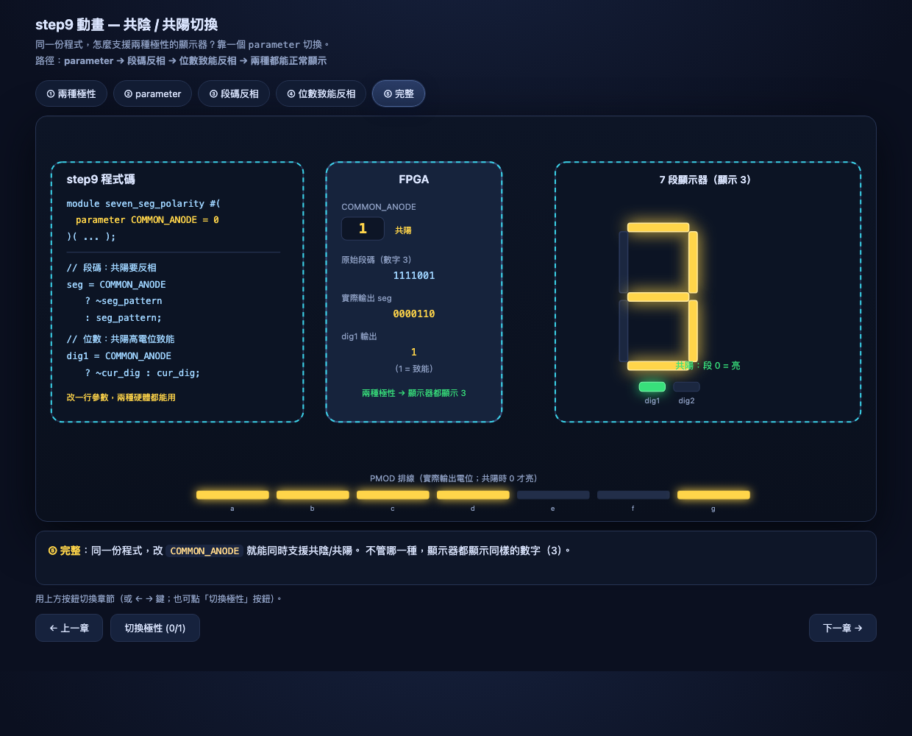

# step9：共陰 / 共陽切換

## 🎬 先看動畫（推薦）

用瀏覽器打開 [`極性動畫.html`](極性動畫.html)，會用 6 個章節示範：
**parameter 切換 → 段碼/位數反相 → 共陰共陽都能用**。



## 目的
同一份程式支援兩種極性的顯示器。

---

## 程式碼說明

### ① parameter（可調參數）
```verilog
module seven_seg_polarity #(
    parameter COMMON_ANODE = 0    // 0 = 共陰；1 = 共陽
)(
    input clk12,
    ...
);
```
- `parameter`：模組的「可調設定」，編譯時決定。
- `= 0`：預設共陰。
- 之後要改，只要改這裡的數字。

### ② 條件運算子切換極性
```verilog
wire [6:0] seg = COMMON_ANODE ? ~seg_pattern : seg_pattern;
```
- 共陰（0）：段碼原樣輸出（1 = 亮）。
- 共陽（1）：段碼**反相**（0 = 亮）。

### ③ 位數致能也要切
```verilog
assign dig1 = COMMON_ANODE ? ~cur_dig : cur_dig;
assign dig2 = COMMON_ANODE ?  cur_dig : ~cur_dig;
```
- 共陰：位數 **0** = 致能。
- 共陽：位數 **1** = 致能。

---

## 執行
```bash
cd step9
make
make prog
```

## 切換極性
打開 `seven_seg_polarity.v` 第 3 行，把 `= 0` 改成 `= 1`，重新 `make prog`。

## 應該看到
不管哪種極性，都能顯示 00~99 每秒 +1。

## 這是最終版
這個就是 `../../seven_seg.v` 的完整實作（多一個參數而已）。
